<div align="center">

# 🚀 CV Helper — AI-Powered Resume & Career Assistant

[](https://flutter.dev)
[](https://dart.dev)
[](https://opensource.org/licenses/MIT)

<p align="center">
  <b>A production-grade, offline-first Flutter application designed to help professionals build stunning resumes, analyze job compatibility with advanced local ATS scanning, generate professional PDF reports, and master career interviews.</b>
</p>

</div>

---

## 🎨 App Banner

<p align="center">
  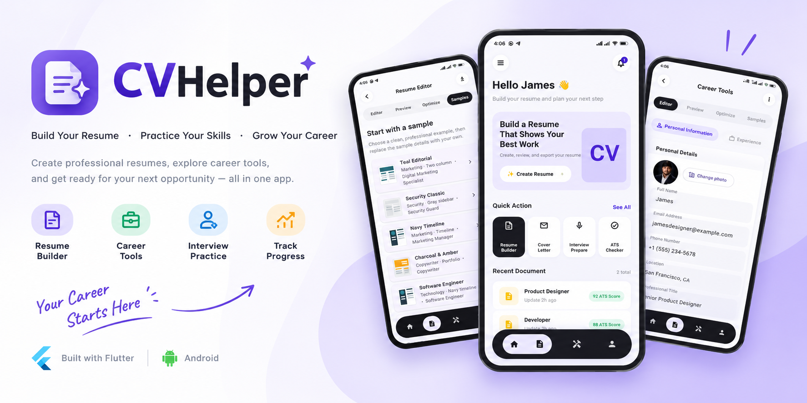
</p>

---

## ✨ Comprehensive Feature Suite

CV Helper is engineered with modern Material 3 design principles, custom state management, smooth transition animations, and robust local services:

1. **🌟 High-Level Animated Splash Screen**
   - Rich brand gradient background (`#7F70EE` to `#16161A`).
   - Spring-physics scale-in logo with floating AI sparkle badge.
   - Professional custom pulsing glowing-dots loader.

2. **🏠 Home Dashboard & Quick Actions**
   - Personalized greeting and AI Assistant readiness status.
   - Interactive AI Promo Banner (`"Land Your Dream Job with AI"`).
   - Quick Action grid for instant access to Resume Builder, Cover Letter Generator, Interview Preparation, and ATS Resume Checker.
   - Recent Document manager displaying live ATS scores.

3. **📂 Professional Navigation Drawer**
   - Slide-out side menu featuring user profile avatar, email, and "✨ AI Assistant Ready" badge.
   - Direct shortcuts to Home, Resume Builder, Career Tools, Saved Cover Letters, Profile Settings, Help & Support, and About.

4. **📝 Advanced Resume Editor & Templates**
   - **Segmented Tabs**: Toggle seamlessly between `Editor`, `Live Preview`, and `✨ AI Optimize`.
   - **Step-by-Step Sections**: Personal Information, Experience, Education, Skills, and Additional Resume Sections (Languages, Projects, References, Interests).
   - **Pre-Built Professional Samples**: Choose from multiple curated resume templates and instant sample content.
   - **Real-Time PDF Export**: Professional A4 PDF generation with instant preview, saving, and local download notifications.

5. **🔍 AI-Powered ATS Resume Scanner**
   - **PDF / Document Picker**: Secure local file selection via `file_picker` with bulletproof text extraction and fallback parsing.
   - **Job Description Analysis**: Multiline requirement matching against a configurable tech skill dictionary (Flutter, Dart, Firebase, State Management, REST APIs, Figma, UI/UX, etc.).
   - **Modern AI Analyzing Screen**: Full-screen processing interface featuring an animated document illustration with a glowing vertical scanning line and 8 real-time processing stages.
   - **Results Dashboard**: Animated match score circular progress indicator, matched & missing keyword chips, resume section verification, and actionable improvement suggestions.
   - **Downloadable PDF Report**: Generate and share a comprehensive ATS analysis report PDF using `pdf` and `printing`.

6. **🛠️ Career Tools & Interview Practice**
   - **Cover Letter Generator**: Create tailored cover letter drafts.
   - **Interview Question Simulator**: Practice role-specific questions with integrated speech-to-text (`speech_to_text`).
   - **Salary Insight & Career Roadmap**: Explore career progression checklists and guidance.

7. **👤 Profile Management & Modern Notifications**
   - Editable personal profile with avatar initials and contact details.
   - Non-intrusive, sleek top-center toast notifications (`toastification`) replacing standard snackbars across all features.

---

## 📸 Screen Gallery

Here is a visual walkthrough of CV Helper's polished interface across its key modules:

| | | |
|:---:|:---:|:---:|
| 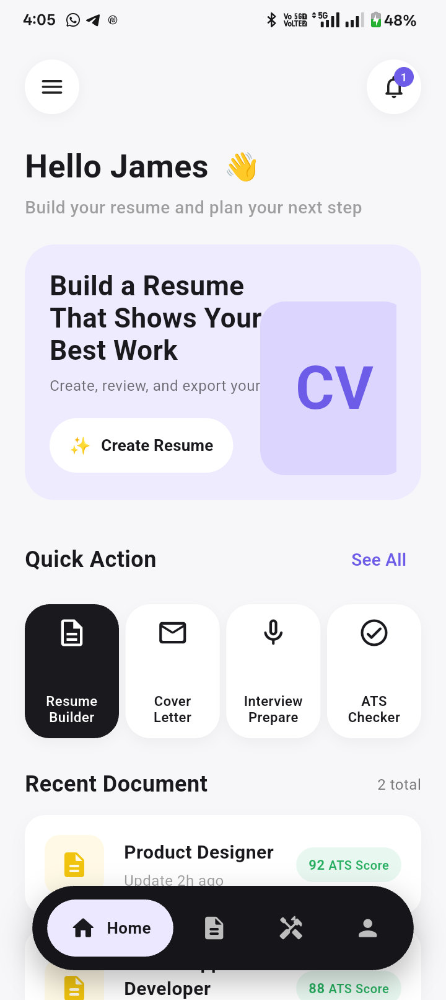 | 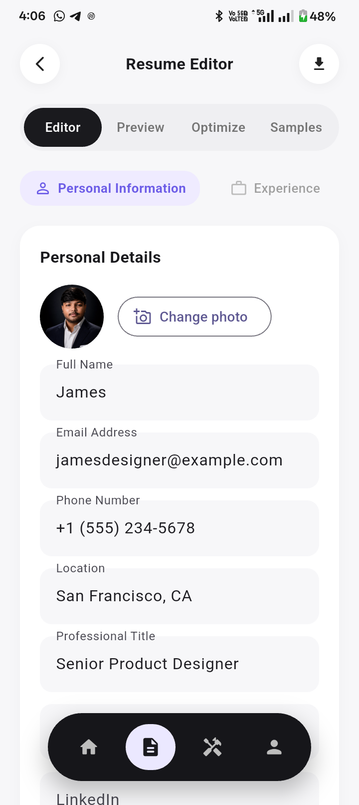 | 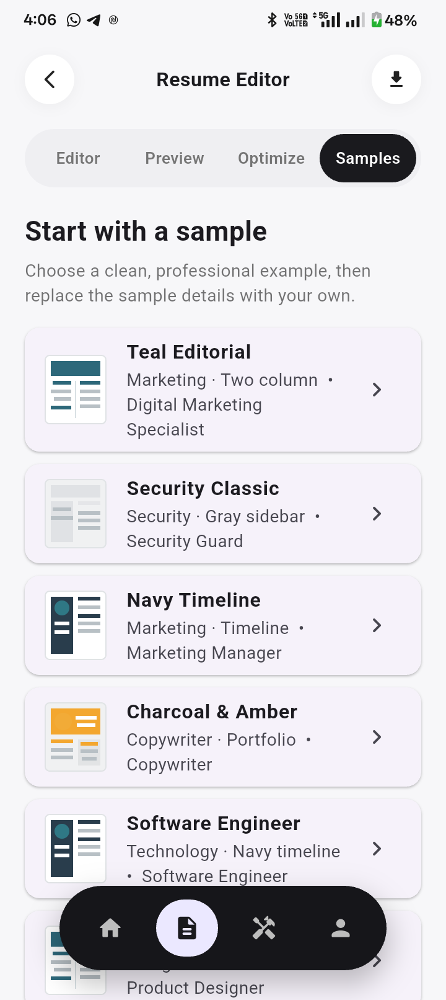 |
| 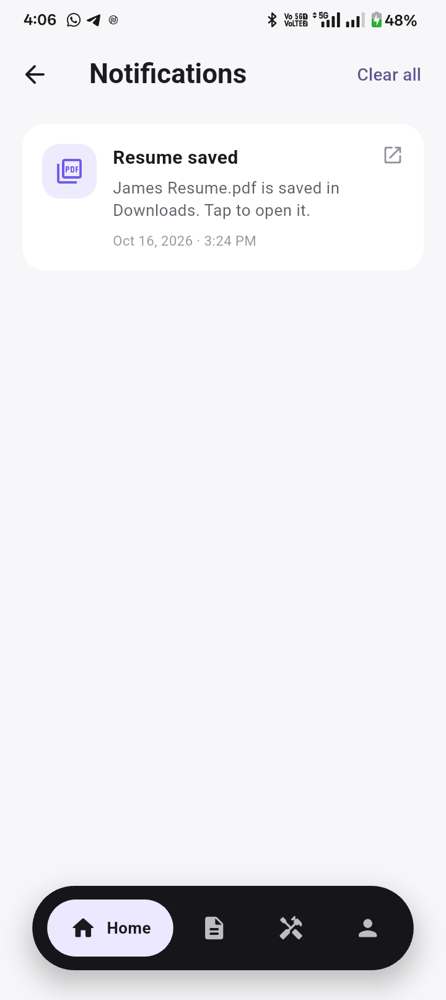 | 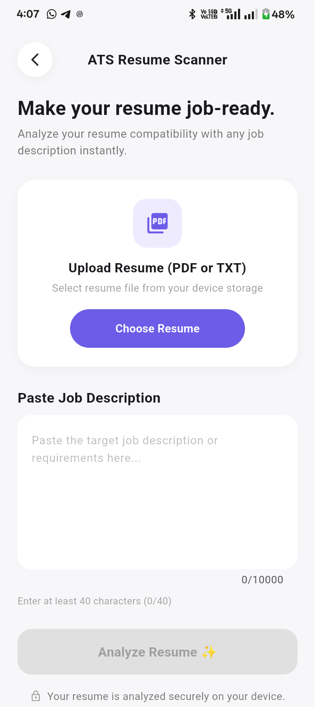 | 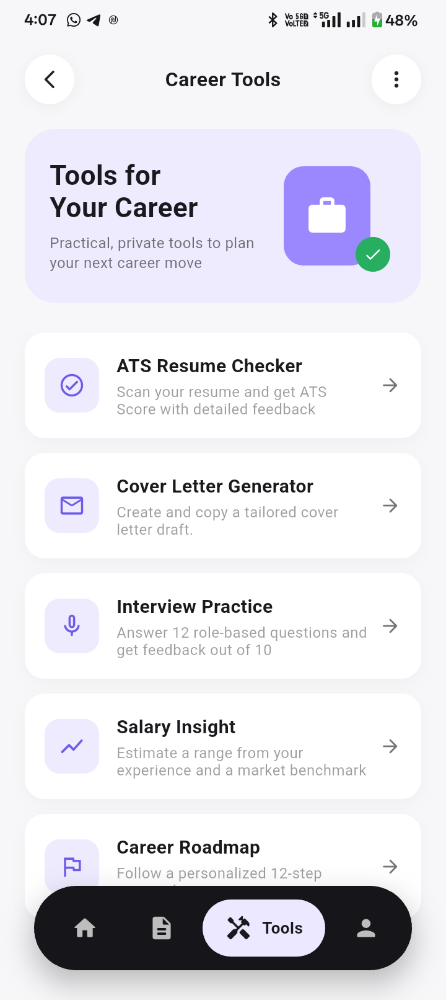 |
| 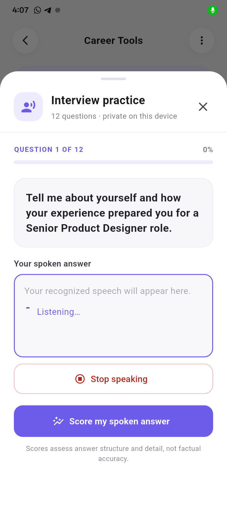 | 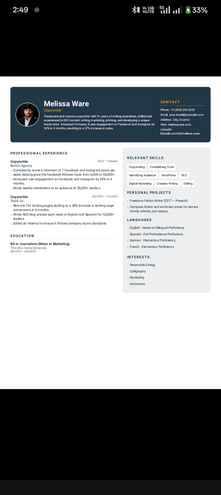 | 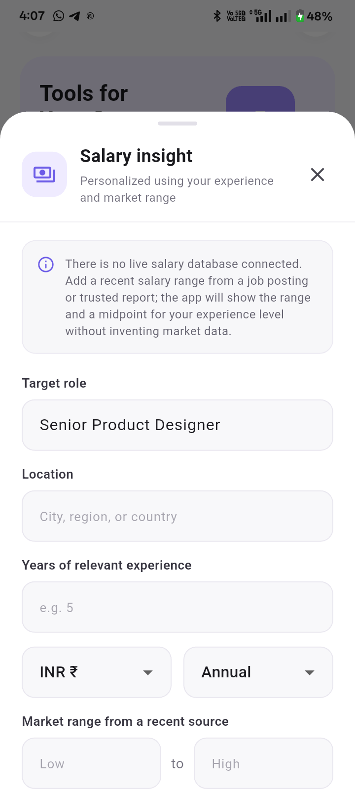 |
| 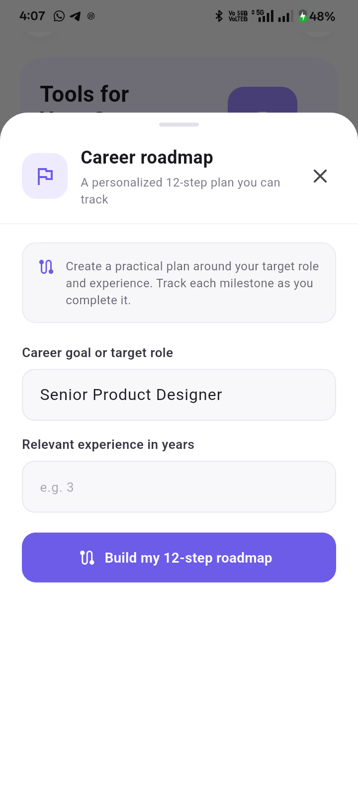 | 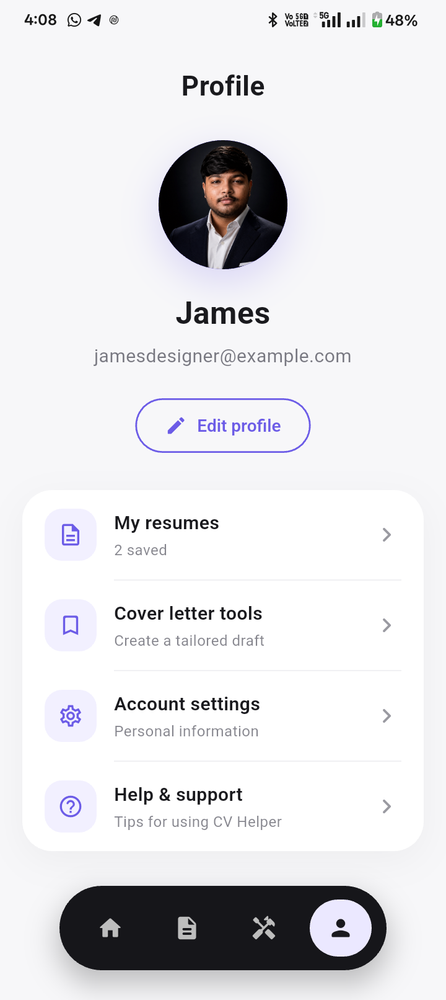 | 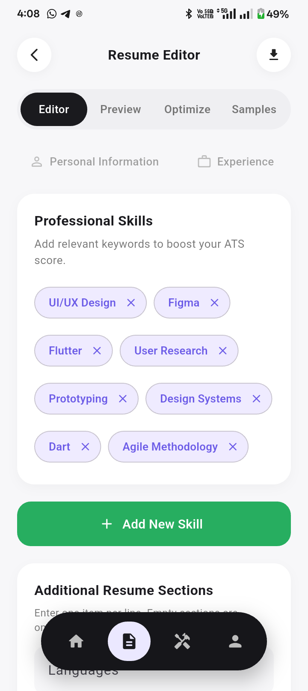 |
| 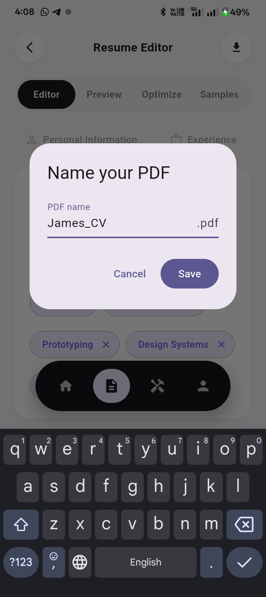 | 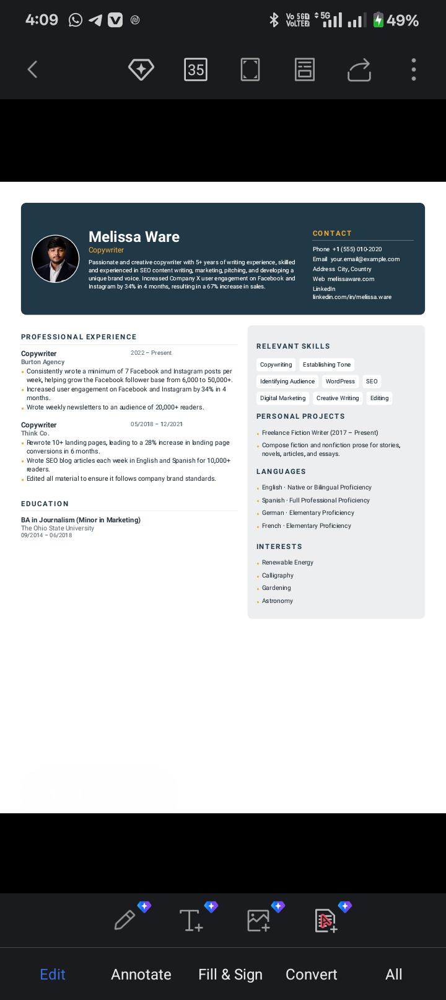 | |

---

## 🚀 Getting Started

### Prerequisites
- [Flutter SDK](https://flutter.dev/docs/get-started/install) (^3.13.5 or higher)
- Android Studio / VS Code with Flutter & Dart plugins.

### Installation & Execution

1. **Clone the repository**:
   ```sh
   git clone https://github.com/your-username/cv-helper.git
   cd cv-helper
   ```

2. **Install dependencies**:
   ```sh
   flutter pub get
   ```

3. **Run the application**:
   ```sh
   flutter run
   ```

4. **Build Debug APK**:
   ```sh
   flutter build apk --debug
   ```

---

## 🔒 Privacy & Offline Operation

- **100% Local Processing**: Resume text extraction and ATS analysis run entirely on your device. No resume contents or job descriptions are uploaded to external servers.
- **No Registration Required**: Immediate access to all resume builder and career tools without login walls.

---

## 📄 License

Distributed under the MIT License. See `LICENSE` for more information.
